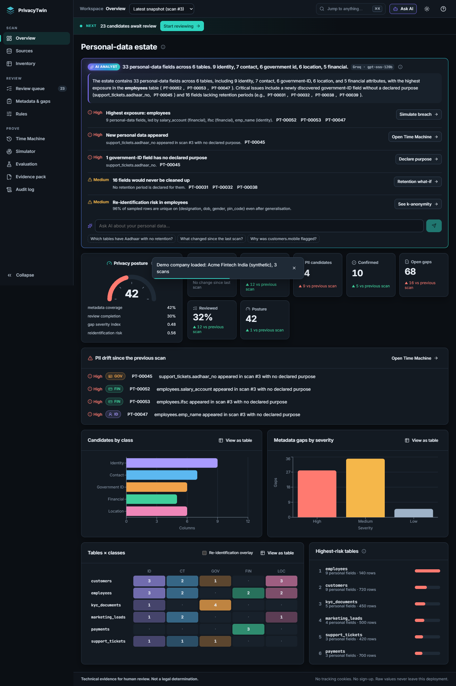
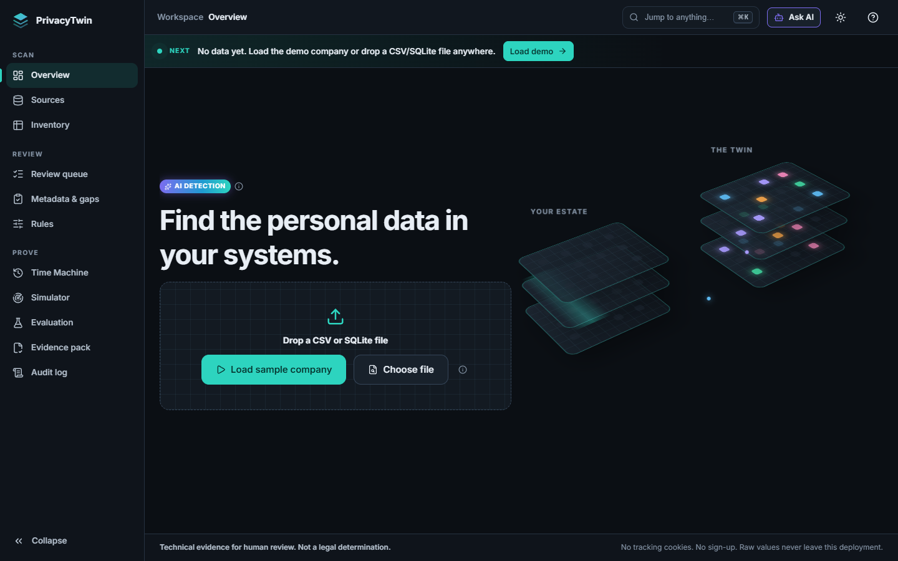
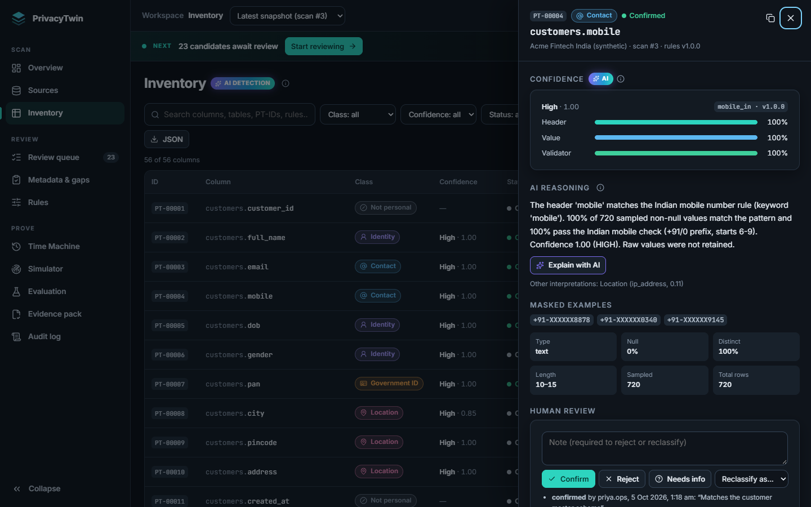
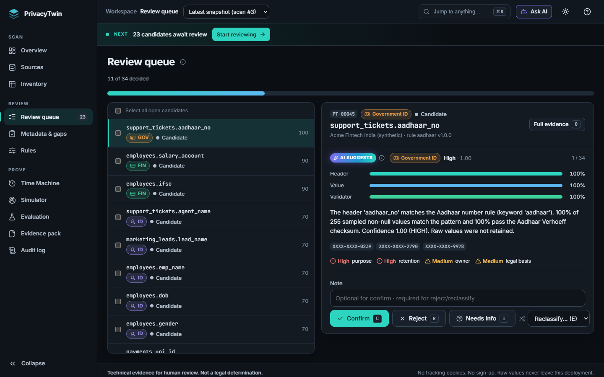
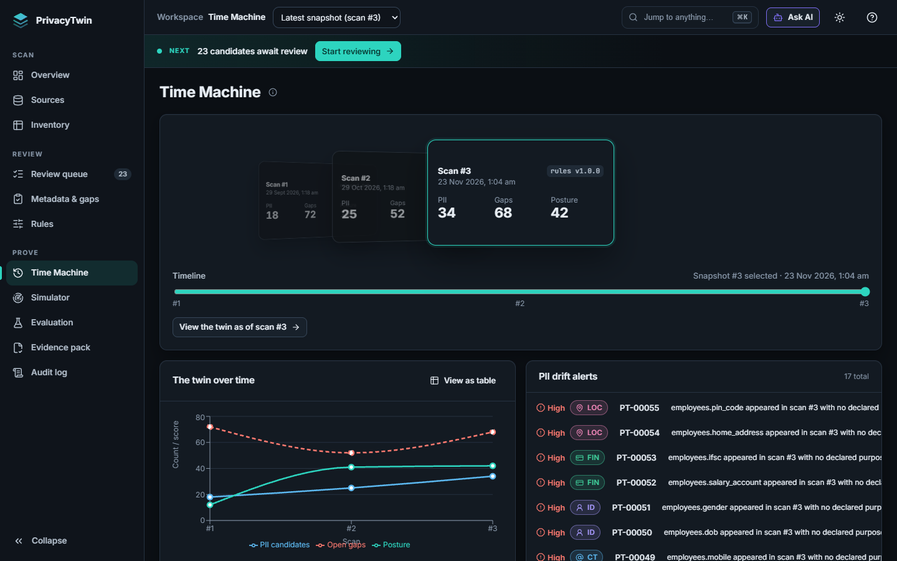
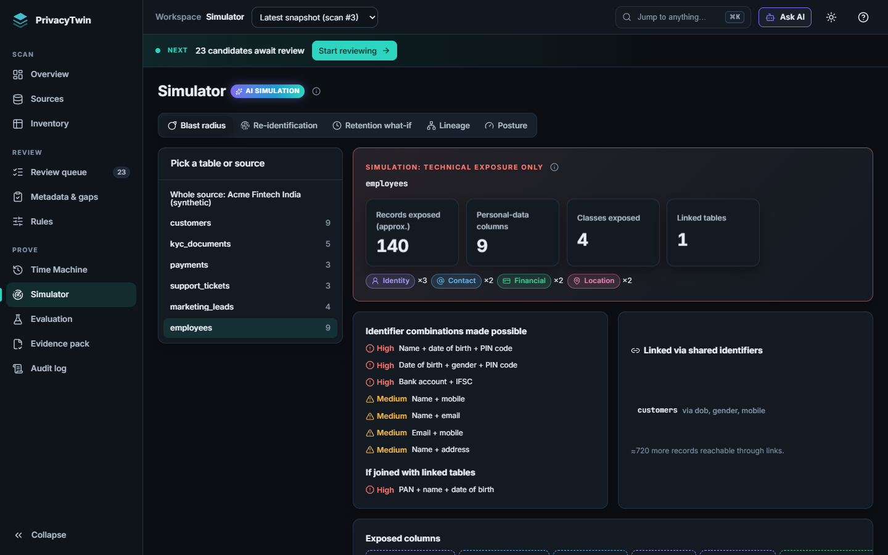
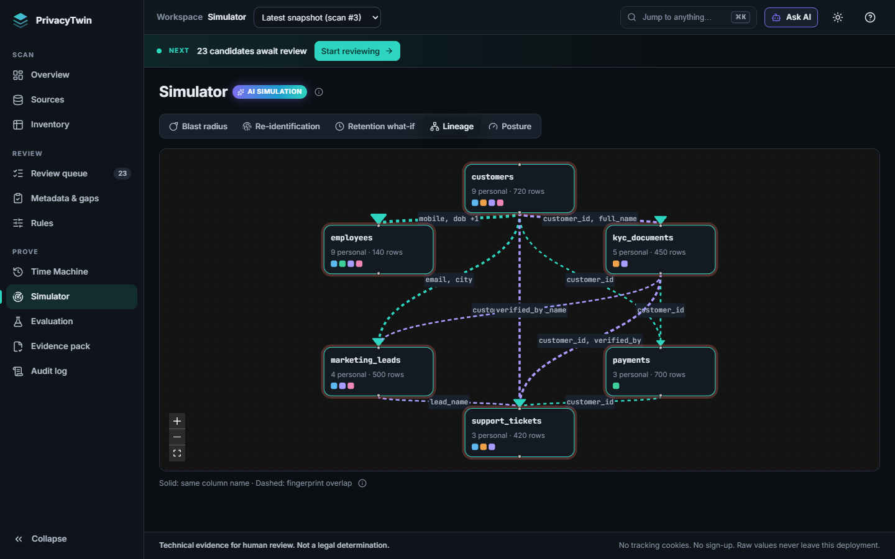
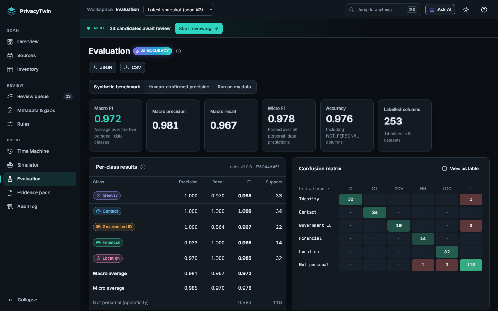
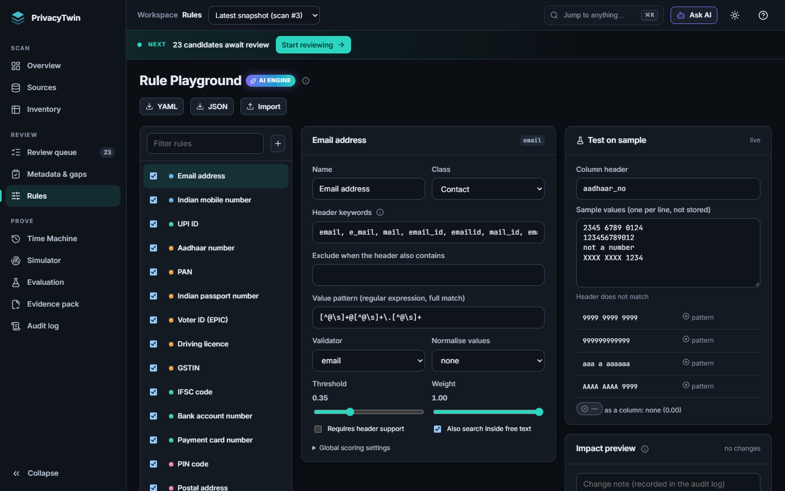
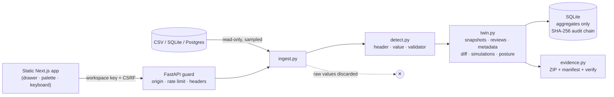

# PrivacyTwin

[](https://github.com/aiori-hackathon/A3-PS019-TC038/actions/workflows/ci.yml)

**Your personal-data estate, mirrored. Evidence, not verdicts.**

**Live demo:** [privacytwin.onrender.com](https://privacytwin.onrender.com/). Hosted on Render's free plan: the first visit after idle shows a wake-up screen (about a minute), and the workspace resets on restart. Click **Load sample company** to explore.

**Proposal:** [slides (PDF)](Proposal/AIROI3_PROPOSAL_PPT.pdf) · [slides (PPTX)](Proposal/PrivacyTwin_AIORI3_Proposal.pptx) · [proposed structure](Proposed-structure-hackathon.pdf) · **Demo guide:** [UI flow and demo guide (PDF)](docs/demo/PrivacyTwin_UI_Flow_and_Demo_Guide.pdf)

PrivacyTwin is a **digital twin of an organisation's personal-data estate** (hackathon problem statement PS-019: personal-data discovery and privacy evidence inventory). Every scan creates a snapshot of the twin. You can:

1. **Discover** where personal data lives: CSV, SQLite and PostgreSQL, with Indian identifiers first (Aadhaar with Verhoeff, PAN, GSTIN with checksum, UPI, IFSC and more).
2. **Rewind** the twin with the Time Machine: diff any two scans, with drift alerts.
3. **Simulate** what-ifs: breach blast radius, re-identification risk (k-anonymity) and retention.
4. **Prove** detection accuracy: published precision and recall on a labelled benchmark, every error explained.
5. **Export** tamper-evident evidence: a ZIP with a SHA-256 manifest you can verify file by file.

**AI is visible end to end**: explainable AI detection on every column, an AI analyst summary on the Overview, Ask AI, and Explain with AI on each finding, powered by **Groq** (`openai/gpt-oss-120b`) when a key is configured and by an offline engine otherwise. Only metadata is sent to the LLM, never raw values.

**Opt-in AI auto-triage**: Sources and Review queue include an Auto-approve toggle (off by default). Enabling it reviews existing untouched HIGH-confidence candidates; new scans also trigger review. Set the minimum detection confidence to 90%, 95% (default), or 100%. The configured LLM must explicitly approve each candidate; there are no offline approvals. Runs consider up to 200 candidates in batches of 20. AI reasons, model, scan and rule version are recorded in the audit chain, and exports identify automated decisions. Each AI approval applies to its assessed scan; rescans require a fresh AI decision. Existing human decisions are preserved; AI approvals are excluded from human-confirmed precision. Undo latest AI batch returns untouched approvals to manual review. Disabling prevents subsequent approvals, including a pending model response. Workspace imports always start with automation off.

It never makes legal determinations. Every page and export says: *Technical evidence for human review. Not a legal determination.*



## Run it locally (3 commands)

Requires Python 3.11+ and Node 20+.

```bash
pip install -r requirements.txt                                # 1. backend dependencies
uvicorn privacytwin.api:app --port 8000                        # 2. API on :8000 (leave running)
cd web && npm ci && npm run dev                                # 3. app on http://127.0.0.1:3000
```

Optional AI: put a Groq API key in `data/groq-key.txt` (git-ignored) or set `GROQ_API_KEY` before step 2.

Open **http://127.0.0.1:3000** and click **Load sample company**. Within a few seconds you get *Acme Fintech India*, a synthetic company with three historical scans, finished reviews and open gaps. Or drop any CSV or SQLite file anywhere in the app.

Development extras: `pip install -r requirements-dev.txt` (tests, Faker for the benchmark generator).

## What a first-time user sees

| | |
| --- | --- |
|  |  |
| **Start screen**: the app opens straight into the job: drop a file or load the sample. | **Evidence card**: three signal bars, rule and version, rationale, masked examples, review, metadata, history, masking preview. |
|  |  |
| **Review queue**: risk-sorted, keyboard only (J/K/C/R/E/I/N/Z), undo toasts, bulk actions. | **Time Machine**: 3D snapshot deck, timeline, diff and drift alerts. |
|  |  |
| **Blast radius**: records, classes, identifier combinations, linked tables. | **Lineage**: tables linked by shared identifiers or keyed fingerprints. |
|  |  |
| **Evaluation**: per-class metrics, confusion matrix, ablation, every error. | **Rule Playground**: live test, impact preview, semantic versions. |

More: [metadata & gaps](docs/screenshots/06-metadata.png) · [evidence pack](docs/screenshots/12-evidence.png) · [audit log](docs/screenshots/13-audit.png) · [light theme](docs/screenshots/14-overview-light.png) · [375px mobile](docs/screenshots/15-mobile.png)

## Architecture



Details: [docs/ARCHITECTURE.md](docs/ARCHITECTURE.md). Screen-by-screen data flow: [docs/UI_FLOW.md](docs/UI_FLOW.md). Exploration guide and full positive/negative test flows: [docs/TEST_GUIDE.md](docs/TEST_GUIDE.md). Automated flow test on a DRDO-style synthetic estate: `python tools/flow_test.py` → [docs/TEST_REPORT_DRDO.md](docs/TEST_REPORT_DRDO.md). The default rule set is documented in [`privacytwin/default_rules.yaml`](privacytwin/default_rules.yaml).

**How confidence works.** For each column and rule: *header* (keyword match on normalised names, including abbreviations like `mob`, `dob`, `cust_nm` and transliterations like `naam`, `pata`), *value* (share of sampled values matching the pattern) and *validator* (share passing a real check). `score = weight × (0.35 header + 0.30 value + 0.35 validator)`, then **HIGH ≥ 0.75 · MEDIUM ≥ 0.55 · LOW ≥ threshold**. Negative rules (order/invoice/sku/txn/timestamps, constant-prefix codes) cut false positives.

## Evaluation results

Synthetic benchmark in [`eval/`](eval/README.md): **253 labelled columns, 14 tables, 8 datasets**, including misleading headers, transliterated headers, look-alike IDs, Luhn-valid device IDs and 90–95% null columns. Reproduce with `python -m privacytwin.eval`.

| Class | Precision | Recall | F1 | Support |
|---|---:|---:|---:|---:|
| IDENTITY | 1.000 | 0.970 | 0.985 | 33 |
| CONTACT | 1.000 | 1.000 | 1.000 | 34 |
| GOVERNMENT_ID | 1.000 | 0.909 | 0.952 | 22 |
| FINANCIAL | 0.933 | 1.000 | 0.966 | 14 |
| LOCATION | 0.970 | 1.000 | 0.985 | 32 |
| **Macro avg** | 0.981 | 0.976 | **0.977** | |
| Micro avg | 0.985 | 0.978 | 0.981 | |

Accuracy including NOT_PERSONAL columns: 0.980.

| Ablation | Macro F1 |
|---|---:|
| Header only | 0.840 |
| Header + value | 0.914 |
| **Header + value + validator** | **0.977** |
| Value + validator (no header) | 0.836 |

The 5 remaining errors are listed with causes in [`eval/results.json`](eval/results.json) and on the Evaluation page: masked Aadhaar values, a DOB under a generic header, a health ID with no rule, and IFSC and city columns of a *branch* table (business objects, not people). **This is synthetic data written by the project team**, so treat it as evidence of how the rules behave, not a guarantee on your data. Use *Evaluation → Run on my data* to measure on your own columns, and *human-confirmed precision* to track reviewer agreement.

## Security design

- **Read-only sources**: SQLite `mode=ro` + `query_only`, with a write-probe self-test shown as a *Read-only verified* badge; PostgreSQL read-only transaction.
- **No raw values persisted**: bounded in-memory samples (500 / 1,000 / 5,000 rows; head, random or stratified); only aggregates, masked examples (`ra****@gmail.com`, `XXXX-XXXX-1234`) and keyed MinHash fingerprints are stored. [`tests/test_no_raw_values.py`](tests/test_no_raw_values.py) fails if any sampled value appears in the database or any export.
- **Isolation without login**: random browser workspace key; origin-bound CSRF tokens on writes; CORS locked to the frontend; rate limits; CSP and other security headers.
- **Tamper evidence**: SHA-256 hash-chained audit log with *Verify integrity*; evidence-pack manifest whose hash is anchored in the chain.
- **LLM boundary**: Groq receives metadata only (names, classes, signal scores, gaps); raw values and masked examples are never sent, enforced by a test. Without a key the app is fully offline.

See [SECURITY.md](SECURITY.md).

## Tests

```bash
python -m pytest -q --cov=privacytwin          # 124 tests; the LLM is disabled in tests
python -m privacytwin.eval --min-macro-f1 0.9  # evaluation gate
cd web && npx playwright test smoke            # needs the API on :8000 and the site on :3000
```

The smoke test opens the app, loads the sample company (about 4–5 s locally), reviews with the keyboard only (confirm, reject with a note, undo with Z), verifies the audit chain, exports the evidence pack and verifies it, and checks the legal footer and the absence of horizontal scroll at 375px. To run it against the static build: `npm run build`, then `python -m http.server 3000 --directory web/out`.

Lighthouse (landing page, served with compression, mobile emulation): Performance 90, Accessibility 100, Best Practices 100, SEO 100. Performance varies a few points between runs.

## Deploy

**Render (live demo):** one Docker web service (`render.yaml` + `Dockerfile.render`) builds the frontend as static files and serves them from the API on the same address; it redeploys automatically on every push to `main`. Set `GROQ_API_KEY` in the Render dashboard to enable the AI features. Cold starts show a *Waking up the server* screen with automatic retries; an optional keep-alive workflow pings `/api/health`.

The frontend can also be hosted separately (e.g. Vercel with `web/vercel.json` and `NEXT_PUBLIC_API_URL`). Full steps: [docs/DEPLOY.md](docs/DEPLOY.md).

## Known limitations

- **Accuracy is measured on synthetic data** we generated; real data will contain formats and contexts the rules have not seen.
- **Context-blind**: a valid IFSC or city in a *branches* table is flagged like a customer's. Reviewers reject these, and the decision is recorded.
- **Masked or tokenised identifiers** (e.g. `XXXX XXXX 1234`) are not detected as personal data.
- **Header-dependent rules** (PIN code, bank account, DOB, age, gender) miss columns with generic names, by design, to avoid false positives on numbers and dates.
- **No MySQL/SQL Server connectors** in this build (use a CSV export). The PostgreSQL connector needs the optional `psycopg` package and was not exercised in CI.
- **Impact preview is approximate** when a rule's pattern or validator changes, because raw values are not kept; it is exact for keyword, weight, threshold and enable/disable changes.
- **Evidence-pack hashes** show integrity after export, not authorship (no signing key).
- **Single-process** rate limiter and SQLite; the free-tier demo resets on redeploy.

## Legal disclaimer

PrivacyTwin provides **technical evidence for human review. It is not a legal determination** and not legal advice. It never issues legal verdicts or legal labels; the product UI and exports avoid that vocabulary entirely (a test enforces it). See *Why we don't decide legality* at `/docs#legality` in the app. All demo and benchmark data is synthetic.

---

The v2 “ReviewGuard” version of this project is preserved at the git tag `v2-reviewguard`.
