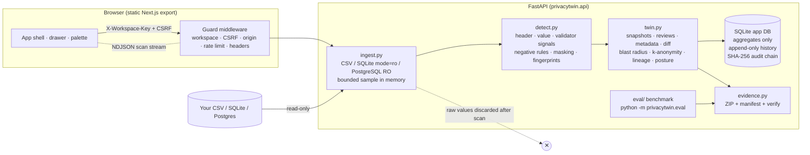

# Architecture

## Data flow of a scan

1. **Ingest** (`ingest.py`): decode (UTF-8 → BOM → cp1252 → Latin-1), detect delimiter, de-duplicate headers; SQLite opens `mode=ro` after a write-probe self-test; tables are sampled (head / random / stratified).
2. **Detect** (`detect.py`): per column, every enabled rule measures header, value and validator signals; `combine()` turns them into a score; negative keywords and constant-prefix codes are penalised; the best rule above threshold sets the class. Output: aggregates, masked examples, keyed fingerprint, rule signals for later re-scoring.
3. **Table aggregates**: k-anonymity on quasi-identifiers and a record-age histogram, computed in memory.
4. **Persist** (`twin.scan`): one transaction writes the scan, findings (stable PT-IDs per column key), table stats and an audit entry. The receipt records what was kept and when raw values were discarded.

## Twin views

`Twin.view(ws, as_of_seq)` assembles the snapshot as of any scan: the latest scan per source, metadata and reviews as of that time (both append-only), effective metadata (column overrides table, field by field), gaps and risk. Every other feature (overview, Time Machine diff, drift, simulator, posture, evidence) is built on it.

## Modules

| Module | Responsibility |
| --- | --- |
| `validators.py` | Checksums and format validators (Verhoeff, Luhn + issuer prefixes, GSTIN, PAN, …) |
| `default_rules.yaml`, `rules.py` | Documented default rule set; validation, semver, content hash, YAML/JSON import/export |
| `detect.py` | Three-signal scoring, rationale, profile, k-anonymity, record-age histogram, aggregate re-scoring |
| `masking.py` | Masked examples, free-text masking, keyed MinHash fingerprints, masking strategies |
| `ingest.py` | Bounded read-only ingestion |
| `store.py` | Schema, workspace lifecycle, hash-chained audit log |
| `gaps.py` | Metadata fields, retention parsing, gap engine, labelled suggestions |
| `twin.py` | Scans, views, reviews, metadata, diff, drift, simulations, posture, rule impact, workspace export/import |
| `evidence.py` | Evidence pack, printable summary, verification |
| `assistant.py` | Offline help assistant over docs and metadata |
| `eval/` | Benchmark runner, metrics, ablation, CLI |
| `api.py` | HTTP API and security middleware |
